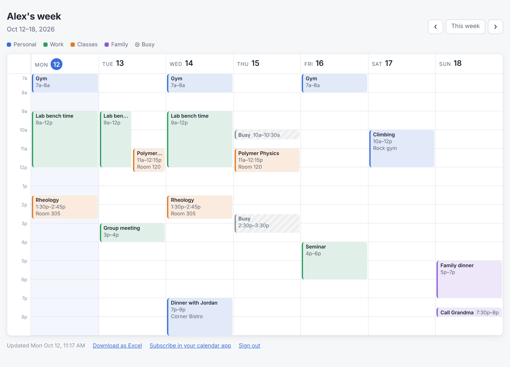
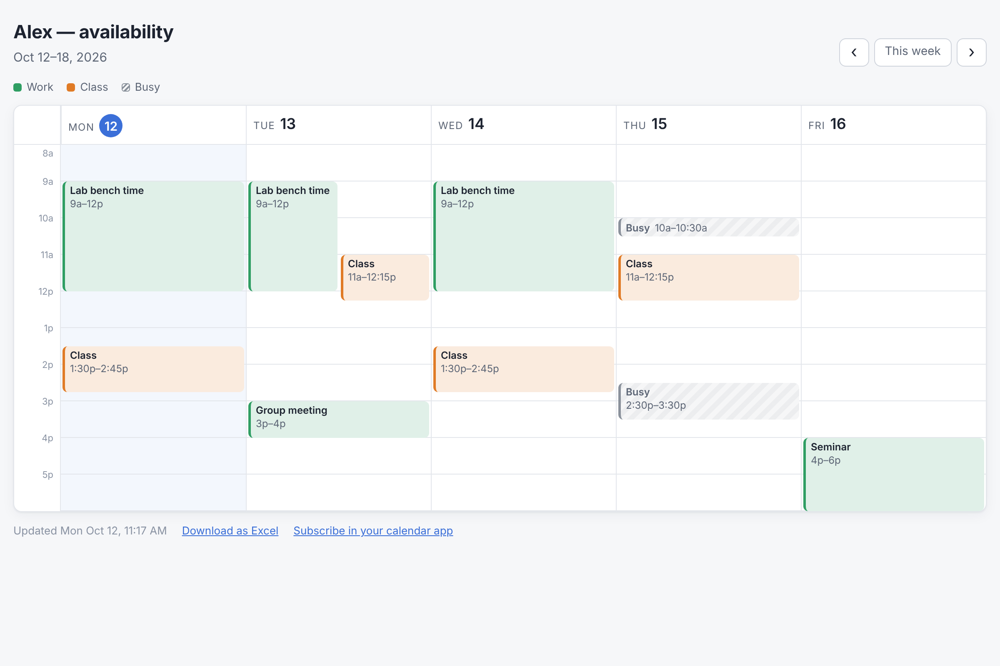
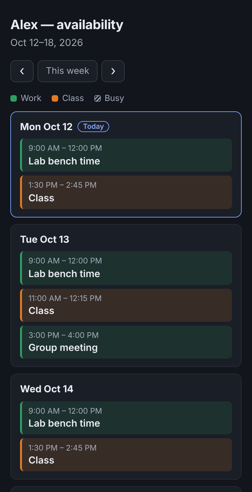

# Glimpse

**Share your schedule without sharing your calendar.**

Glimpse merges your Google, Outlook/Microsoft 365 and iCloud calendars into one weekly view, then lets you decide, person by person and calendar by calendar, how much each viewer sees. Your partner can see everything; coworkers can see "Busy" blocks during work hours; a calendar can be hidden from someone entirely. Each audience gets its own link, with an optional password.

It runs on your own computer. Raw calendar data never leaves it; only already-filtered pages do.



<table>
<tr>
<td width="62%"></td>
<td></td>
</tr>
<tr>
<td><sub>Coworkers: weekdays 8–6 only, work titles, classes shown as "Class", everything else "Busy"</sub></td>
<td><sub>Phones get a day-by-day list; dark mode follows the device</sub></td>
</tr>
</table>

## Features

- **Any number of calendars** from Google, Outlook / Microsoft 365, iCloud, or anything else that publishes an ICS feed.
- **Five detail levels**, set per audience *and* per calendar: `full`, `title`, `label`, `busy`, `hidden`.
- **Time windows**: show an audience only certain days and hours (e.g. Mon–Fri 8:00–18:00).
- **Per-event overrides**: put `#private` in an event to make it "Busy" for everyone, or `#hide` to hide it. Events marked Private in Outlook/Google are treated as `#private` automatically.
- **Optional passwords** per audience (Argon2-hashed, rate-limited, 30-day sign-in).
- **Excel download** of any visible week, and a **subscribe-able ICS feed** so viewers can add your (filtered) schedule to their own calendar app.
- Recurring events, moved/cancelled instances, all-day and overnight events, and daylight-saving changes all handled.
- No JavaScript, no tracking, no database. One Python process.

## How privacy works

```
Google ─┐
Outlook ─┼─► fetch + cache ─► expand recurrences ─► APPLY POLICY ─► render HTML / Excel / ICS ─► tunnel ─► viewer
iCloud ─┘        (your PC)                          (per audience)
```

- **Filtering happens on the server, before rendering.** If an audience may not see a title, the title is never put in the HTML, the Excel file, or the feed. There's nothing hidden "in the page" to dig out.
- **Busy blocks are anonymous**: no calendar name, no colour, no original event ID. Overlapping busy blocks are merged, so viewers can't count your meetings.
- **Overrides only reduce detail**, never increase it.
- **Feed links stay on your PC** in `.env`. They're never logged (even in error messages) and the on-disk cache uses hashed file names.
- **Unguessable links**: each audience's address contains a random 128-bit slug. Pages send `noindex`, `no-store`, `no-referrer` and a strict Content-Security-Policy.
- Glimpse listens on `127.0.0.1` only. The outside world reaches it through a tunnel (Tailscale Funnel or Cloudflare Tunnel), so no router ports are opened.

The test suite checks these rules directly, e.g. that no forbidden word appears anywhere in a coworker's HTML, Excel file or ICS feed.

## Try the demo (2 minutes)

Requires Python 3.11+.

```bash
git clone https://github.com/<you>/glimpse.git
cd glimpse
python -m venv .venv
.venv/bin/pip install -e .            # Windows: .venv\Scripts\pip install -e .
.venv/bin/glimpse -c examples/demo/config.yaml serve
```

Then open:

- Coworker view (no password): <http://127.0.0.1:8000/a/demo-coworker-link-00>
- Partner view (password `demo-password`): <http://127.0.0.1:8000/a/demo-partner-link-000>

## Set it up for real (Windows)

### 1. Install

```powershell
git clone https://github.com/<you>/glimpse.git
cd glimpse
powershell -ExecutionPolicy Bypass -File scripts\windows\setup.ps1
```

This creates `.venv`, installs Glimpse, and creates `config.yaml` and `.env` (both git-ignored) with a fresh secret key.

On macOS/Linux: `python3 -m venv .venv && .venv/bin/pip install -e .`, then copy `config.example.yaml` → `config.yaml` and `.env.example` → `.env`, and set `GLIMPSE_SECRET_KEY` with `glimpse new-secret`.

### 2. Get your feed links

Each calendar has a private link that apps can read. Paste each one into `.env`, **never** into `config.yaml`. Treat them like passwords.

| Provider | Where to find the link |
| --- | --- |
| **Google Calendar** | Settings ⚙ → Settings → pick the calendar under "Settings for my calendars" → *Integrate calendar* → **Secret address in iCal format**. ([help](https://support.google.com/calendar/answer/37648)) |
| **Outlook.com / Microsoft 365** | Settings ⚙ → Calendar → Shared calendars → **Publish a calendar** → choose the calendar and the most detailed option → Publish → copy the **ICS** link. ([help](https://support.microsoft.com/en-US/Outlook/share-your-calendar-in-outlook-com)) |
| **iCloud** | Calendar on Mac → hover the calendar → Share → tick **Public Calendar** → copy the link (iPhone: Calendars → ⓘ → Public Calendar → Share Link). `webcal://` links work as-is. ([help](https://support.apple.com/guide/calendar/icl32362)) |

Publish with full details. Glimpse does the filtering, so it needs the full data to work with. Work and school accounts sometimes disable these options; if so, ask your IT admin.

If a link ever leaks, reset it at the source: Google has a **Reset** button, Outlook lets you unpublish and republish, and iCloud lets you turn public sharing off and on.

### 3. Describe your calendars and audiences

Edit `config.yaml`. The [example](config.example.yaml) is commented line by line. The key ideas:

```yaml
calendars:
  personal: { name: Personal, url: ${GOOGLE_PERSONAL_ICS} }
  lab:      { name: Lab,      url: ${OUTLOOK_LAB_ICS} }
  classes:  { name: Classes,  url: ${OUTLOOK_CLASSES_ICS}, label: Class }

audiences:
  coworkers:
    slug: ${COWORKER_SLUG}
    default: busy                    # any calendar not listed below
    hours: { days: [mon, tue, wed, thu, fri], start: "08:00", end: "18:00" }
    calendars:
      lab: title                     # show titles from the lab calendar
      classes: label                 # show "Class" instead of the course name
```

| Level | The viewer sees |
| --- | --- |
| `full` | title, time, location, notes |
| `title` | title and time |
| `label` | the calendar's `label` (e.g. "Class") and time |
| `busy` | an anonymous "Busy" block |
| `hidden` | nothing |

Then fill in the rest of `.env`:

```powershell
.venv\Scripts\glimpse new-slug        # run once per audience, paste into .env
.venv\Scripts\glimpse hash-password   # for each password-protected audience
```

Put password hashes in **single quotes** in `.env` (they contain `$`).

### 4. Check it

```powershell
.venv\Scripts\glimpse check                       # validates config, fetches every feed
.venv\Scripts\glimpse preview --audience coworkers # prints exactly what coworkers will see
```

### 5. Put it online with Tailscale Funnel (free)

1. Install [Tailscale](https://tailscale.com/download) on the PC and sign in (the free Personal plan is enough).
2. In a terminal: `tailscale funnel --bg 8000` and approve Funnel when asked.
3. Your public address is `https://<pc-name>.<tailnet>.ts.net`. Put it in `.env` as `GLIMPSE_BASE_URL`.

Prefer Cloudflare? A Cloudflare Tunnel pointed at `http://127.0.0.1:8000` works the same way (it needs a domain you own on Cloudflare).

### 6. Start it automatically with Windows

From PowerShell **run as administrator**, in the repo folder:

```powershell
powershell -ExecutionPolicy Bypass -File scripts\windows\install-task.ps1
```

This registers a Task Scheduler task that starts Glimpse at boot (even before you log in), restarts it if it stops, and writes output to `logs\glimpse.log`. Remove it with `scripts\windows\uninstall-task.ps1`.

### 7. Share

```powershell
.venv\Scripts\glimpse links
```

prints each audience's page link and calendar-subscription link. Send the link and the password through different channels (e.g. link by email, password by text).

**To revoke someone's access**, change that audience's slug (and password) in `.env` and restart Glimpse. Old links and sign-ins stop working immediately.

## Commands

| Command | What it does |
| --- | --- |
| `glimpse serve` | run the web app |
| `glimpse check` | validate config and fetch every feed; exit code 0 = all OK |
| `glimpse preview -a NAME [-w YYYY-MM-DD]` | print what an audience sees for a week |
| `glimpse links` | print each audience's links |
| `glimpse new-slug` / `new-secret` | generate random values for `.env` |
| `glimpse hash-password` | hash a password for `.env` |

All commands take `-c path/to/config.yaml` (default `./config.yaml`) and `-e path/to/.env` (default: beside the config).

## Good to know

- Feeds refresh every `refresh_minutes` (default 10). Google and Outlook may themselves update their published feeds only every few minutes to hours, so very recent changes can take a while to show up.
- If a feed fails, Glimpse keeps showing the last good copy and the page footer notes that calendars may be out of date.
- All-day events at the `busy` level are hidden by default (they're usually birthdays and reminders). Set `show_all_day_busy: true` to show them.
- Events marked "show as free" never appear as Busy, only at `title`/`full`.
- The calendar-subscription link works without the password (calendar apps can't sign in), so treat it like the password. Turn it off for an audience with `allow_ics: false`.
- Testing locally over `http://127.0.0.1` works in Chrome and Edge. If another browser keeps returning you to the login page, it's refusing the secure cookie over plain http; use Chrome/Edge or go through your tunnel's https address.
- Login rate limiting is per client IP when your tunnel forwards it (`X-Forwarded-For`), and per audience in any case.

## Development

```bash
pip install -e ".[dev]"
pytest
ruff check src tests && ruff format --check src tests
pip install pre-commit && pre-commit install   # secret scanning + lint on every commit
```

The privacy rules live in [`src/glimpse/policy.py`](src/glimpse/policy.py) as pure functions with no web or network code, so they're easy to test. See [CONTRIBUTING.md](CONTRIBUTING.md) and [SECURITY.md](SECURITY.md).

## License

[MIT](LICENSE) © 2026 Brandon T. McReynolds
