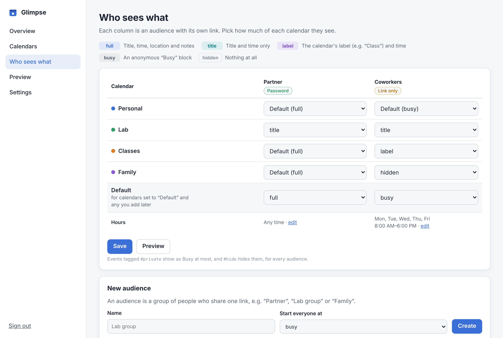
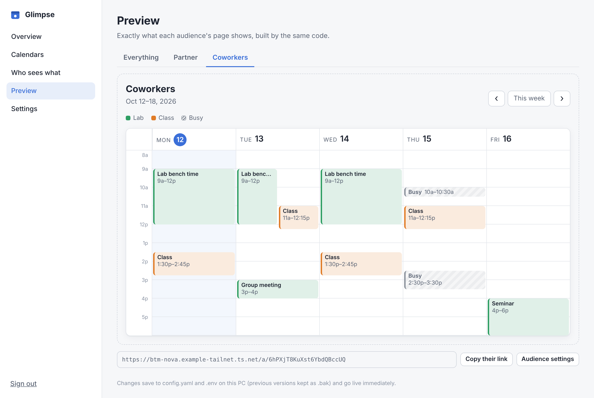

# Glimpse

**Share your schedule without sharing your calendar.**

Glimpse merges your Google, Outlook/Microsoft 365 and iCloud calendars into one weekly view, then lets you decide, person by person and calendar by calendar, how much each viewer sees. Your partner can see everything; coworkers can see "Busy" blocks during work hours; a calendar can be hidden from someone entirely. Each audience gets its own link, with an optional password.

It runs on your own computer. Raw calendar data never leaves it; only already-filtered pages do.


<table>
<tr>
<td width="62%"></td>
<td></td>
</tr>
<tr>
<td><sub>Coworkers: weekdays 8–6 only, work titles, classes shown as "Class", everything else "Busy"</sub></td>
<td><sub>Phones get a day-by-day list; dark mode follows the device</sub></td>
</tr>
</table>

## Features

- **Settings panel in your browser**: add calendar links, decide who sees what, and preview every audience's exact view. Works from any device on your Tailscale network (Mac, Windows, phone); never exposed publicly.
- **Any number of calendars** from Google, Outlook / Microsoft 365, iCloud, or anything else that publishes an ICS feed.
- **Five detail levels**, set per audience *and* per calendar: `full`, `title`, `label`, `busy`, `hidden`.
- **Time windows**: show an audience only certain days and hours (e.g. Mon–Fri 8:00–18:00).
- **Per-event overrides**: put `#private` in an event to make it "Busy" for everyone, or `#hide` to hide it. Events marked Private in Outlook/Google are treated as `#private` automatically.
- **Optional passwords** per audience (Argon2-hashed, rate-limited, 30-day sign-in), and one-click "new link" to cut off access.
- **Excel download** of any visible week, and a **subscribe-able ICS feed** so viewers can add your (filtered) schedule to their own calendar app.
- Recurring events, moved/cancelled instances, all-day and overnight events, and daylight-saving changes all handled.
- Runs on Windows, macOS or Linux. One Python process, no database, no tracking.

<table>
<tr>
<td width="50%"></td>
<td></td>
</tr>
<tr>
<td><sub>Who sees what: one dropdown per calendar and audience</sub></td>
<td><sub>Preview: the exact page an audience gets, before you share it</sub></td>
</tr>
</table>

## How it fits together

```
                         ┌──────────────── your always-on PC ────────────────┐
Google  ─┐               │                                                   │
Outlook ─┼── ICS feeds ──►  Glimpse  ── :8000 public pages ── Tailscale Funnel ──► anyone with a link
iCloud  ─┘               │           ── :8001 settings     ── Tailscale Serve  ──► only your devices
                         └───────────────────────────────────────────────────┘
```

- **Public pages** (port 8000) are what you share. Tailscale **Funnel** puts them on the internet at `https://<pc>.<tailnet>.ts.net`.
- **The settings panel** (port 8001) is only published with Tailscale **Serve**, which is reachable from devices signed in to *your* tailnet and nobody else, at `https://<pc>.<tailnet>.ts.net:8443`. It also needs its own admin password, and can be limited to specific Tailscale accounts.
- Both listen on `127.0.0.1` only, so nothing on your router is opened.

## How privacy works

- **Filtering happens on the server, before rendering.** If an audience may not see a title, the title is never put in the HTML, the Excel file, or the feed. There's nothing hidden "in the page" to dig out.
- **Busy blocks are anonymous**: no calendar name, no colour, no original event ID. Overlapping busy blocks are merged, so viewers can't count your meetings.
- **Overrides only reduce detail**, never increase it.
- **Feed links stay on your PC** in `.env` (owner-only file permissions). The panel shows them masked; they're never logged, even in error messages, and the on-disk cache uses hashed file names.
- **Unguessable links**: each audience's address contains a random 128-bit slug. Pages send `noindex`, `no-store`, `no-referrer` and a strict Content-Security-Policy.

The test suite checks these rules directly, e.g. that no forbidden word appears anywhere in a coworker's HTML, Excel file or ICS feed, and that the panel never prints a feed link.

## Try the demo (2 minutes)

Requires Python 3.11+.

```bash
git clone https://github.com/<you>/glimpse.git
cd glimpse
python -m venv .venv
.venv/bin/pip install -e .            # Windows: .venv\Scripts\pip install -e .
.venv/bin/glimpse -c examples/demo/config.yaml serve --no-admin
```

Then open:

- Coworker view (no password): <http://127.0.0.1:8000/a/demo-coworker-link-00>
- Partner view (password `demo-password`): <http://127.0.0.1:8000/a/demo-partner-link-000>

## Set it up

You need [Python 3.11+](https://www.python.org/downloads/) and [Tailscale](https://tailscale.com/download) (free Personal plan) on the computer that will host Glimpse, and Tailscale on any device you want to edit settings from.

### 1. Install (on the host)

**Windows** (PowerShell, in the folder you cloned or unzipped):

```powershell
powershell -ExecutionPolicy Bypass -File scripts\windows\setup.ps1
```

**macOS / Linux:**

```bash
./scripts/unix/setup.sh
```

This creates `.venv`, installs Glimpse, and on first run creates `config.yaml` and `.env` (both git-ignored), asking you to choose a **settings-panel password** (10+ characters).

### 2. Put it on Tailscale

**Windows:**

```powershell
powershell -ExecutionPolicy Bypass -File scripts\windows\tailscale-setup.ps1
```

**macOS / Linux** (or by hand on Windows):

```bash
tailscale funnel --bg 8000                                  # public share links
tailscale serve --bg --https=8443 http://127.0.0.1:8001     # settings panel, your devices only
.venv/bin/glimpse set-base-url https://<this-pc>.<tailnet>.ts.net
```

The first Funnel command may open a browser to approve Funnel and HTTPS for your tailnet. Both settings are remembered by Tailscale across reboots.

### 3. Start it automatically

| Host | Command | Notes |
| --- | --- | --- |
| Windows | `scripts\windows\install-task.ps1` (PowerShell **as administrator**) | Starts at boot, even before you log in; restarts if it stops; logs to `logs\glimpse.log`. Undo with `uninstall-task.ps1`. |
| macOS | `./scripts/unix/install-macos.sh` | launchd agent, starts at login. Undo with `--uninstall`. |
| Linux | `./scripts/unix/install-linux.sh` | systemd user service. Undo with `--uninstall`. |

### 4. Open the settings panel from any device

On any computer or phone signed in to your tailnet, open:

```
https://<host-name>.<tailnet>.ts.net:8443
```

(On the host itself, `http://127.0.0.1:8001` works too.) Sign in with the admin password, then:

1. **Calendars → Add a calendar.** Paste a feed link, press **Test link** to check it, then **Add calendar**. The page explains where each provider keeps its link (also below).
2. **Who sees what → New audience**, e.g. "Partner" starting at `full`, "Coworkers" starting at `busy`.
3. In the grid, choose a level for each calendar and audience. Open an audience to set **days and hours**, a **password**, how many weeks ahead they can browse, and whether Excel/subscriptions are allowed.
4. **Preview** shows exactly what each audience will see. "Everything" shows all calendars, for you only.
5. **Overview** lists every share link with a Copy button.

Every change is checked before it's saved, takes effect immediately (no restart), and the previous `config.yaml`/`.env` are kept as `.bak`.

### Getting your feed links

Each calendar has a private link that apps can read. Treat these like passwords.

| Provider | Where to find the link |
| --- | --- |
| **Google Calendar** | Settings ⚙ → Settings → pick the calendar under "Settings for my calendars" → *Integrate calendar* → **Secret address in iCal format**. ([help](https://support.google.com/calendar/answer/37648)) |
| **Outlook.com / Microsoft 365** | Settings ⚙ → Calendar → Shared calendars → **Publish a calendar** → choose the calendar and the most detailed option → Publish → copy the **ICS** link. ([help](https://support.microsoft.com/en-US/Outlook/share-your-calendar-in-outlook-com)) |
| **iCloud** | Calendar on Mac → hover the calendar → Share → tick **Public Calendar** → copy the link (iPhone: Calendars → ⓘ → Public Calendar → Share Link). `webcal://` links work as-is. ([help](https://support.apple.com/guide/calendar/icl32362)) |

Publish with full details. Glimpse does the filtering, so it needs the full data to work with. Work and school accounts sometimes disable these options; if so, ask your IT admin.

If a link ever leaks, reset it at the source: Google has a **Reset** button, Outlook lets you unpublish and republish, and iCloud lets you turn public sharing off and on. Then paste the new link under **Calendars → Edit**.

### Sharing and revoking

Send the link and the password through different channels (e.g. link by email, password by text). To cut someone off, open their audience and press **Make a new link** (and change the password). The old link and every existing sign-in stop working at once.

## Detail levels

| Level | The viewer sees |
| --- | --- |
| `full` | title, time, location, notes |
| `title` | title and time |
| `label` | the calendar's label (e.g. "Class") and time |
| `busy` | an anonymous "Busy" block |
| `hidden` | nothing |

## Editing config by hand (optional)

Everything the panel does is stored in `config.yaml`, with secrets in `.env` referenced as `${NAME}`. Hand edits are fine; a running Glimpse picks them up on its own, and if an edit is invalid it keeps the previous settings and shows the error in the panel. See the commented [config.example.yaml](config.example.yaml).

## Commands

| Command | What it does |
| --- | --- |
| `glimpse serve` | run the public pages (8000) and settings panel (8001); `--no-admin` to skip the panel |
| `glimpse init` | create `config.yaml` + `.env` for a fresh setup |
| `glimpse admin-password` | set or reset the settings-panel password |
| `glimpse set-base-url URL` | set the public address used in share links |
| `glimpse check` | validate config and fetch every feed; exit code 0 = all OK |
| `glimpse preview -a NAME [-w YYYY-MM-DD]` | print what an audience sees for a week |
| `glimpse links` | print each audience's links |
| `glimpse new-slug` / `new-secret` / `hash-password` | generate values for hand-edited configs |

All commands take `-c path/to/config.yaml` (default `./config.yaml`) and `-e path/to/.env` (default: beside the config).

## Good to know

- Feeds refresh every 10 minutes by default (Settings). Google and Outlook may themselves update their published feeds only every few minutes to hours, so very recent changes can take a while to show up.
- If a feed fails, Glimpse keeps showing the last good copy; the Overview shows which calendar has a problem.
- All-day events at the `busy` level are hidden by default (they're usually birthdays and reminders). There's a checkbox per audience to show them.
- Events marked "show as free" never appear as Busy, only at `title`/`full`.
- The calendar-subscription link works without the password (calendar apps can't sign in), so treat it like the password, or turn subscriptions off for that audience.
- Forgot the admin password? On the host, run `glimpse admin-password`.
- Testing over plain `http://127.0.0.1` works in Chrome and Edge. If another browser keeps returning you to a login page, it's refusing the secure cookie over plain http; use the `https://…ts.net` address instead.

## Development

```bash
pip install -e ".[dev]"
pytest
ruff check src tests && ruff format --check src tests
pip install pre-commit && pre-commit install   # secret scanning + lint on every commit
```

The privacy rules live in [`src/glimpse/policy.py`](src/glimpse/policy.py) as pure functions with no web or network code, so they're easy to test. See [CONTRIBUTING.md](CONTRIBUTING.md) and [SECURITY.md](SECURITY.md).

## License

[MIT](LICENSE) © 2026 Brandon T. McReynolds
